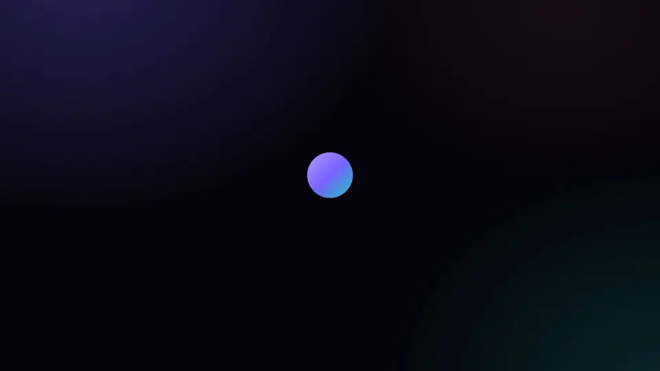
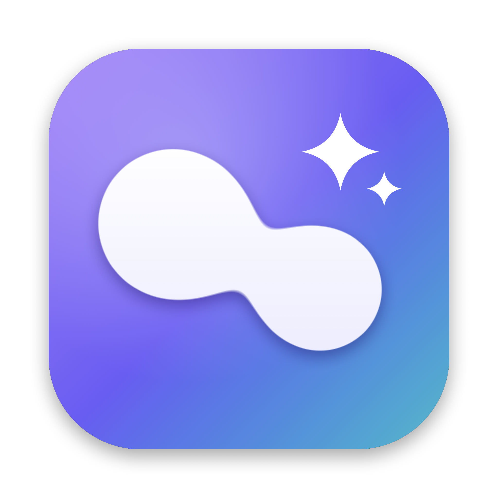

<p align="center">
  <a href="https://hollowbit.dev/fuseduo/"></a>
</p>

<h1 align="center"> Fuseduo</h1>

<p align="center"><b>Drop one Mac app onto another. Claude writes the automation, you read it, it runs.</b></p>

<p align="center">
  <a href="https://github.com/hollowbit-dev/fuseduo/releases/latest"></a>
  <a href="https://github.com/hollowbit-dev/fuseduo/releases"></a>
  <a href="LICENSE"></a>
  
  <a href="https://github.com/hollowbit-dev/fuseduo/stargazers"></a>
</p>

<p align="center">
  <a href="https://github.com/hollowbit-dev/fuseduo/releases/latest/download/Fuseduo-1.0.0-mac-arm64.dmg"></a>
  <a href="https://github.com/hollowbit-dev/fuseduo/releases/latest/download/Fuseduo-1.0.0-mac-x64.dmg"></a>
</p>

<p align="center"><sub>
  <a href="https://hollowbit.dev/fuseduo/">Website</a> · ▶ <a href="https://hollowbit.dev/fuseduo/">Watch the 20-second film</a> · Homebrew: <code>brew tap hollowbit-dev/tap &amp;&amp; brew trust hollowbit-dev/tap &amp;&amp; brew install --cask fuseduo</code>
</sub></p>

Fuseduo is a board of every app on your Mac. Drag one app onto another and it suggests three things
those two apps could do together. Pick one, or describe your own, and it writes the automation as a
real script (AppleScript, JavaScript for Automation or zsh), checks that it compiles, and shows you in
plain English exactly what it will do. Nothing runs until you approve it. Keep the ones you like, run
them again in one click, or turn one into a real Mac app with its own icon.

Free and open source, from [Hollowbit Studio](https://hollowbit.dev). The app isn't signed with a paid
Apple certificate: the first time, right-click Fuseduo in Applications and choose **Open**.

## How it works

1. **Drag** one app onto another.
2. **Pick** one of three ideas, or type your own.
3. **Review** the plan: the steps, a risk rating, the macOS permissions it needs and how to undo it.
4. **Run** it once you approve, save it to your fusions, or turn it into a **Mac app** with its own icon.

Every script goes through a compile check (`osacompile` / `zsh -n`) and a safety block-list
(deleting files, `sudo`, sending messages, piping downloads into a shell and more) before the Run
button is enabled.

## AI

Fuseduo uses Claude. With no setup it uses the Claude Code CLI if it is installed and signed in,
so it runs on your existing Claude plan. You can also add an Anthropic API key in Settings; it is
stored encrypted with the macOS keychain.

## Speed

Settings › Speed picks the model: **Best** (Claude Opus 5.5, the default) or **Fast** (Claude Sonnet 5.5,
about 3× quicker in testing). The one repair pass after a failed compile always uses Opus. Ideas are
cached per pair for 7 days and start loading while you hover one app over another.

## Run from source

```sh
npm install
npm start
```

- `FUSE_MOCK=1 npm start` uses canned answers, for working on the UI without calling Claude.
- `node scripts/ui-test.cjs dark|light` drives the app in mock mode with Playwright and saves screenshots.
- `swift scripts/make-icon.swift assets/icon.png` redraws the app icon.

## Layout

| Path | What it does |
| --- | --- |
| `src/main.js` | Window, IPC, Claude calls, compile check, running scripts, saved fusions |
| `src/apps.js` | Finds installed apps, their icons, colours and categories |
| `src/prompts.js` | The prompts and JSON schemas for ideas and builds |
| `src/guard.js` | The safety block-list |
| `scripts/ui-test.cjs`, `scripts/refine-test.cjs` | Mock-mode UI tests (Playwright) |
| `src/renderer/` | The board, drag physics, fusion animation and panel |

MIT licence. © 2026 Hollowbit Studio.

---

<p align="center"><sub>If Fuseduo made something click for you, a ⭐ helps other people find it.</sub></p>
